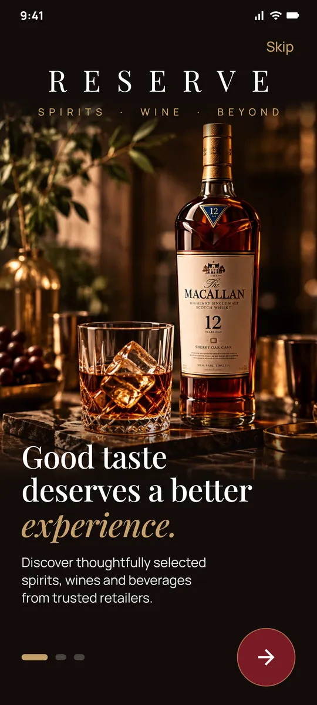
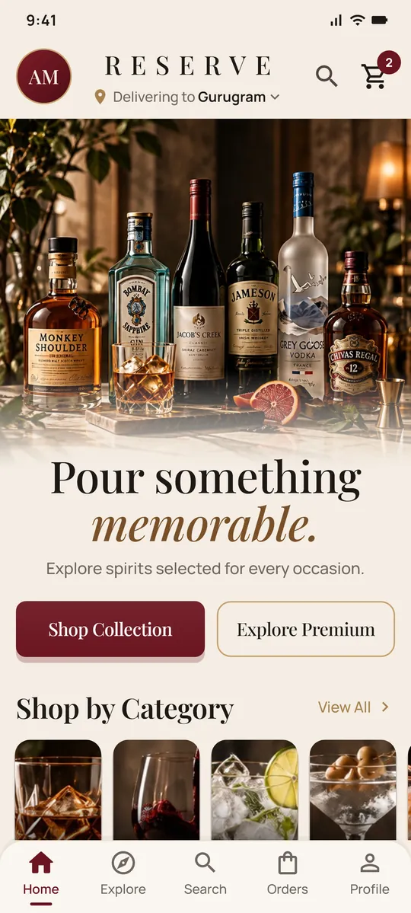
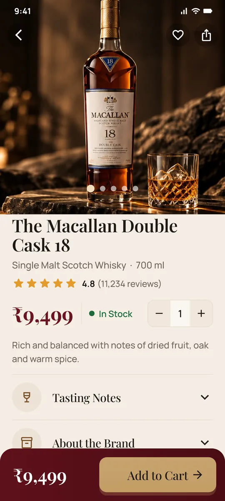
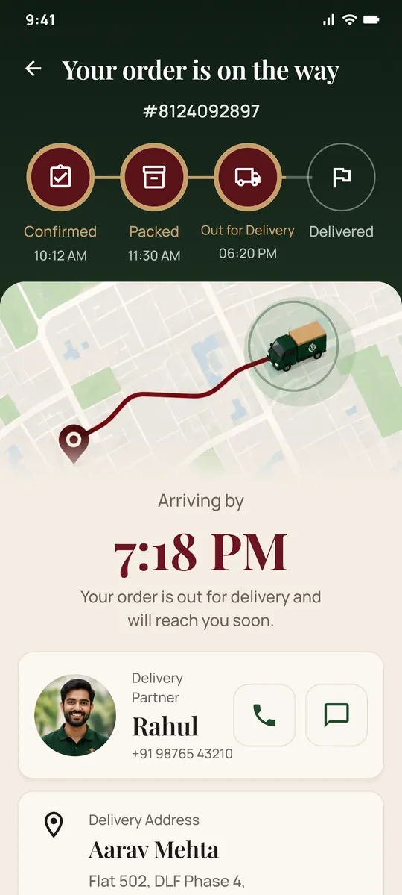

# Reserve — Spirits · Wine · Beyond

A Flutter app for a premium liquor store, rebuilt from 26 high-fidelity UI concept screens.
It runs fully offline on local sample data; no backend is needed.

**[Download page](https://noopur-design.github.io/reserve/)** ·
**[Download the APK](https://noopur-design.github.io/reserve/Reserve.apk)**
(Android 7.0+, 52.9 MB) · [All releases](https://github.com/Noopur-design/reserve/releases)

<p>
  
  
  
  
</p>

> Concept and portfolio demo: no real sales, payments or deliveries. Product and brand names and bottle
> images come from AI-generated design mockups and are used only to illustrate the UI; not affiliated with
> any brand. For adults of legal drinking age. Drink responsibly.

### Install on Android

Open the APK link on an Android phone, allow your browser to install unknown apps when asked, then tap
**Install**. If Play Protect warns about an unknown developer, choose **More details → Install anyway**.
APK files don't run on iPhone or iPad.

## Screens

| Flow | Screens |
|---|---|
| Onboarding | Intro, category explorer, 18+ age gate, delivery city picker, sign in (with forgot password and create account sheets) |
| Shop | Home, Explore/Search (recent, trending, brands, categories, live results, simulated voice search), category listing (filter, sort, brand and price sheets), product detail (gallery, quantity, accordions, wishlist, share) |
| Checkout | Cart (quantity changes, swipe to delete with undo, instructions, summary), 3-step checkout (address, delivery with a scheduling sheet, payment with an age confirmation) |
| Orders | My Orders (status tabs, search, sort), live tracking (animated progress that auto-completes to Delivered), delivered/cancelled details, reorder and buy again |
| Profile | Profile, wishlist, saved addresses (add, edit, delete, set default), payment methods (add card, UPI or net banking; set default; remove), delivery preferences, notifications, responsible drinking, help & support (FAQ), chat with a scripted assistant (order lookup: try `8124092817`), terms & privacy and the policy pages |

A bottom navigation bar (Home · Explore · Search · Orders · Profile) appears on the main tabs and on the
profile sub-pages, as in the reference screens.

## Project structure

```
lib/
  main.dart                 app entry, Provider setup
  theme/app_theme.dart      colours, text styles (Playfair Display + Manrope), ₹ formatting
  data/                     models + local sample data (products, cities, FAQs, policies)
  state/app_state.dart      ChangeNotifier store: cart, wishlist, orders, addresses, prefs
  widgets/                  reusable buttons, cards, tiles, bottom nav, sheets, address form
  screens/                  one file per screen
assets/images/              photography cropped from the reference screens
assets/fonts/               bundled fonts (work offline)
web/                        web shell: index.html (loading screen), flutter_bootstrap.js, manifest, icons
tool/                       build_web.ps1 (web release), web_icons.py (web icons), screenshots/
test/                       unit/widget tests + a smoke test that renders every screen at 360dp and 412dp
```

## Requirements

- Flutter 3.47+ (installed at `C:\src\flutter`; add `C:\src\flutter\bin` to your PATH)
- Android SDK with NDK 28.2.13676358 (already installed)
- JDK: Android Studio's bundled JBR (already set with `flutter config --jdk-dir`)

## Run on a physical Android phone

### USB debugging
1. On the phone, open **Settings → About phone** and tap **Build number** 7 times to turn on Developer options.
2. In **Settings → Developer options**, turn on **USB debugging**. On Xiaomi/Redmi/POCO phones, also turn on
   **Install via USB** and **USB debugging (Security settings)**.
3. Connect the USB cable and accept the "Allow USB debugging?" prompt.
4. Check that the phone is listed, then run the app:

```bash
flutter devices
```

```bash
flutter run
```

### Wireless debugging (Android 11+)
1. Connect the phone and PC to the same Wi-Fi network.
2. In **Developer options → Wireless debugging**, turn it on and tap **Pair device with pairing code**.
3. Pair and connect using the IP and ports shown on the phone:

```bash
adb pair PHONE_IP:PAIRING_PORT
```

```bash
adb connect PHONE_IP:DEBUG_PORT
```

```bash
flutter run
```

(`adb` is at `%LOCALAPPDATA%\Android\Sdk\platform-tools\adb.exe`.)

## Build an installable APK

```bash
flutter build apk --debug
```

The APK is written to `build/app/outputs/flutter-apk/app-debug.apk`. Copy it to the phone and open it
to install (allow "Install unknown apps" if asked), or install it over USB:

```bash
adb install -r build/app/outputs/flutter-apk/app-debug.apk
```

## Web version (any device, embeddable in a website)

The same app also builds for the web. On a computer it is shown inside a phone frame
(`lib/widgets/web_frame.dart`); on a phone, or in a ~412 px wide iframe, it fills the screen.

```powershell
powershell -ExecutionPolicy Bypass -File tool\build_web.ps1
```

This runs `flutter build web --release --no-source-maps`, sets `<base href="./">` so the build works from
any folder of a website, and writes `dist/reserve-web/` plus `dist/Reserve-web-v<version>.zip`.
`dist/WEBSITE-SETUP.txt` explains uploading and embedding; `dist/website-embed.html` is an example page with
a copy-paste snippet. To try it locally, serve the folder over HTTP (not `file://`), for example
`python -m http.server 8000 --directory dist/reserve-web`. Web icons are redrawn with
`python tool/web_icons.py`.

Web differences: profile photos are stored as data URLs in browser storage (no file system), and the age
gate's Exit button shows a hint instead of closing the app.

## Tests

```bash
flutter analyze
```

```bash
flutter test
```

## Notes

- App ID: `com.reserve.liquor`, label **Reserve**, locked to portrait.
- Sign-in, social login, payments, calls and maps are simulated. The demo sends no data anywhere.
- Product photography and illustrations are cropped from the provided reference screenshots.
